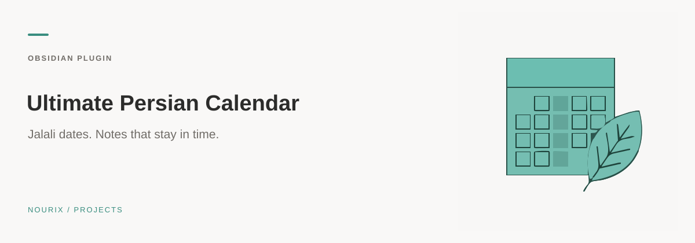

<sub>کاور مفهومی تولیدشده با هوش مصنوعی؛ اسکرین‌شات برنامه نیست.</sub>

<div align="center">


# Ultimate Persian Calendar

[English](README.en.md)

**یادداشت‌های زنده، تقویم شمسی و API انتخاب تاریخ — در Obsidian.**

[عبارت‌های زنده](docs/LIVE-EXPRESSIONS.md) · [نصب](#نصب) · [مرجع API](docs/API.md) · [ساخت Release](docs/RELEASING.md)


</div>

## از اینجا شروع کنید

| نیاز شما | راهنما |
| --- | --- |
| کاربر افزونه | [نصب](#نصب) · [استفاده](#استفاده) |
| توسعه‌دهندهٔ افزونهٔ دیگر | [مرجع API](docs/API.md) · [نمونهٔ مصرف‌کننده](docs/examples/picker-consumer.ts) |
| عبارت‌ها و انتشار | [عبارت‌های زنده](docs/LIVE-EXPRESSIONS.md) · [انتشار](docs/RELEASING.md) |

API انتخاب تاریخ، محلی و داخل Obsidian است؛ سرویس HTTP یا API ابری نیست.

## این پلاگین چیست؟

Ultimate Persian Calendar یک پلاگین Obsidian با تقویم جلالی و رابط راست‌به‌چپ است. می‌توانید روزها و مناسبت‌ها را ببینید، یادداشت روزانه، ماهانه یا سالانه بسازید و تاریخ را در متن درج کنید.

**بله، API دارد:** پلاگین‌های دیگر Obsidian می‌توانند با `api.pickDate()` پنجرهٔ انتخاب تاریخ را باز کنند. این یک **API داخلی و محلی** است؛ سرور، endpoint عمومی HTTP، کلید API یا سرویس ابری ارائه نمی‌کند.

> کاور و تصویر عبارت‌ها، تصویرسازی رفتار هستند؛ پیش‌نمایش تنظیمات از کد واقعی در یک میزبان شبیه‌سازی‌شده تهیه شده است، نه اجرای بومی Obsidian. همهٔ تصاویر با وزیرمتن رندر و متن آن‌ها به مسیر برداری تبدیل شده تا نمایش فونت در GitHub وابسته به نصب فونت نباشد.

## عبارت‌های زنده

**یک‌بار بنویس، همیشه مقدار تازه ببین.** به‌جای ویرایش دستی ساعت، تاریخ، درصد پیشرفت یا شمارش تا نوروز، عبارت را با الگوی `{#عبارت}` وارد کنید:

```markdown
ساعت فعلی: {#ساعت}
تاریخ امروز: {#تاریخ}
پیشرفت سال: {#پیشرفت*سال}
روز تا نوروز: {#تا*نوروز}
```


- `{ساعت}` **ثابت** است؛ فقط ساعت لحظهٔ تایپ را ثبت می‌کند.
- `{#ساعت}` **زنده** است؛ مقدار نمایشی آن در یادداشت رندرشده با گذشت زمان تغییر می‌کند.
- این تغییرها روی **نمایش** انجام می‌شوند؛ فایل Markdown هر ثانیه بازنویسی نمی‌شود.
- از تنظیمات می‌توانید حالت ثابت/زنده را مستقل کنترل کنید و فاصلهٔ تازه‌سازی را روی **۱، ۵، ۳۰ یا ۶۰ ثانیه** بگذارید.
- `{#تست}` فقط مثالِ الگوست: اگر «تست» عبارت شناخته‌شده‌ای نباشد، تبدیل نمی‌شود؛ ساخت متغیر یا اجرای کد سفارشی ارائه نمی‌شود.

Reading view نمایش مرجع است. رفتار Source mode، ذخیرهٔ `span` و محدودیت‌های Live Preview را در [راهنمای کامل عبارت‌های زنده](docs/LIVE-EXPRESSIONS.md) بخوانید.

## قابلیت‌ها

| قابلیت              | رفتار                                                                             |
| ------------------- | --------------------------------------------------------------------------------- |
| تقویم جلالی         | نمایش ماه، تاریخ میلادی روزها، امروز و جمعه‌ها؛ حرکت بین ماه‌ها                   |
| یادداشت‌های دوره‌ای | ساخت یا باز کردن یادداشت روزانه، ماهانه و سالانه؛ نام و پوشهٔ قابل تنظیم          |
| مناسبت‌ها           | دریافت داده از دو منبع عمومی؛ نمایش رویدادها و نشان تعطیلی                        |
| استفادهٔ آفلاین     | تقویم و انتخاب تاریخ بدون اینترنت؛ مناسبت‌های قبلاً دریافت‌شده از کش              |
| عبارت‌های زنده      | تازه‌سازی مقادیر یادداشت با `{#عبارت}`؛ کنترل مستقل حالت ثابت/زنده و فاصلهٔ زمانی |
| API انتخاب تاریخ    | خروجی شمسی، میلادی، ISO، timestamp، object یا قالب سفارشی؛ حداقل/حداکثر تاریخ     |

## نصب

### ساخت از سورس — روش فعلی

نیازمندی: **Node.js 22** و npm.

```bash
git clone --branch refactor/clean-calendar-api https://github.com/Ali-Nourix/Ultimate-Persian-Calendar.git
cd Ultimate-Persian-Calender
npm ci
npm run build
```

فقط این سه فایل را به پوشهٔ زیر کپی کنید:

```text
YourVault/.obsidian/plugins/persian-ultimate-calendar/
├── main.js
├── manifest.json
└── styles.css
```

سپس Obsidian را دوباره بارگذاری و پلاگین را از **Settings → Community plugins** فعال کنید. برای نصب دستی باید حالت محدود (Restricted mode) خاموش باشد؛ فقط کدی را فعال کنید که به آن اعتماد دارید.

> ثبت در فهرست Community Plugins یا وجود فایل در Releases را فرض نکنید. تا انتشار نسخهٔ آماده، از روش ساخت بالا استفاده کنید. شناسهٔ نصب همچنان `persian-ultimate-calendar` است تا تنظیمات و مصرف‌کننده‌های قبلی حفظ شوند.

## استفاده

### تقویم و یادداشت‌ها

1. روی آیکون تقویم در نوار ابزار کلیک کنید، یا در Command Palette دستور **«باز کردن تقویم فارسی»** را اجرا کنید.
2. روی یک روز کلیک کنید تا مناسبت‌های آن نمایش داده شود.
3. دوبارکلیک روی روز یا دکمهٔ **یادداشت روزانه**، یادداشت را می‌سازد یا فایل موجود را باز می‌کند.
4. عنوان ماه و سال در تقویم، یادداشت ماهانه و سالانه را باز می‌کنند.

تنظیمات پیش‌فرض:

| تنظیم              | پیش‌فرض      | توضیح                                                     |
| ------------------ | ------------ | --------------------------------------------------------- |
| پوشهٔ یادداشت‌ها   | `Journal`    | مسیر داخل Vault                                           |
| نام یادداشت روزانه | `YYYY-MM-DD` | تاریخ **شمسی**؛ مثال `1404-01-01.md`                      |
| نام یادداشت ماهانه | `YYYY-MM`    | مثال `1404-01.md`                                         |
| نام یادداشت سالانه | `YYYY`       | مثال `1404.md`                                            |
| نمایش مناسبت‌ها    | روشن         | خاموش‌کردن، دریافت جدید و نمایش مناسبت‌ها را متوقف می‌کند |

در نام فایل از `/` یا `\` استفاده نکنید؛ مسیر را در تنظیم پوشه وارد کنید. فایل موجود باز می‌شود و محتوای آن بازنویسی نمی‌شود.

## تنظیمات جدید

سه تب، به‌جای یک صفحهٔ طولانی و درهم:

| تب             | کنترل‌ها                                                                            |
| -------------- | ----------------------------------------------------------------------------------- |
| عبارت‌های زنده | پیش‌نمایش مقدارها، فعال‌سازی مستقل ثابت/زنده، فاصلهٔ به‌روزرسانی و راهنمای عبارت‌ها |
| یادداشت‌ها     | اعتبارسنجی مسیر و نام فایل، نمونهٔ نام امروز و بازگرداندن فقط قالب‌های پیش‌فرض      |
| مناسبت‌ها      | وضعیت کش، دریافت تازه، تازه‌کردن وضعیت بدون شبکه و حذف با تأیید داخل Obsidian       |


وضعیت ذخیره/خطا روشن است، تغییر نام فایل‌ها یادداشت‌های قبلی را جابه‌جا نمی‌کند و کنترل‌ها با عرض باریک سازگارند. وزیرمتن در تصاویر تثبیت شده؛ رابط واقعی از فونت نصب‌شده/تم شما پیروی می‌کند و فونت را از اینترنت بارگیری نمی‌کند.

## API انتخاب تاریخ

```ts
import type { CalendarPluginApi } from "./src/api";

// Obsidian's plugin registry is internal: isolate access and check availability.
const registry = (
  app as unknown as {
    plugins?: { plugins?: Record<string, { api?: CalendarPluginApi }> };
  }
).plugins?.plugins;
const api = registry?.["persian-ultimate-calendar"]?.api;

if (api) {
  const result = await api.pickDate({
    title: "انتخاب موعد",
    initialDate: "1404/01/01",
    minDate: "1404/01/01",
    maxDate: "1404/12/29",
    outputFormat: "iso",
  });
  if (result) console.log(result.iso, result.jalali);
  // Cancel / Escape / close → null
}
```

نمونهٔ کامل پلاگین مصرف‌کننده: [picker-consumer.ts](docs/examples/picker-consumer.ts). قرارداد TypeScript قابل کپی، همهٔ خروجی‌ها، دسترسی ایمن به پلاگین و رفتار لغو در [مرجع API](docs/API.md) آماده‌اند.

شبکهٔ انتخاب تاریخ همیشه **شمسی** است؛ `calendar: "gregorian"` نمای میلادی جداگانه ایجاد نمی‌کند. جزئیات فرمت‌ها، ورودی‌ها، محدوده‌ها و رفتار لغو را در [مرجع API](docs/API.md) بخوانید.

## مناسبت‌ها، کش و حریم خصوصی

- منابع: [pipe2time](https://github.com/hmarzban/pipe2time.ir) و [Persian Holidays API](https://github.com/BaseMax/persian-holidays-api).
- هنگام فعال‌بودن مناسبت‌ها، پلاگین برای دریافت JSON به دامنه‌های `hmarzban.github.io` و `basemax.github.io` درخواست می‌فرستد. متن یادداشت، نام فایل و محتوای Vault در این درخواست‌ها ارسال نمی‌شود؛ ارائه‌دهندگان مثل هر سرویس وب IP درخواست را می‌بینند.
- کش در `data.json` خود پلاگین، در کنار تنظیمات و جدا برای هر Vault نگهداری می‌شود. کش قدیمی `localStorage` منتقل نمی‌شود؛ یک بار دریافت تازه انجام می‌شود.
- بازهٔ دریافت: ۱۲ ماه گذشته، ماه جاری و ۲۴ ماه آینده؛ مجموع ۳۷ ماه. درخواست‌های تکراری یک منبع در یک چرخه با هم مشترک‌اند.
- اعتبار کش پس از دریافت موفق برای همهٔ ماه‌ها یک سال است. دادهٔ قدیمی در دریافت ناقص حفظ می‌شود و شکست کامل هر دو منبع به‌عنوان ماه خالی موفق ذخیره نمی‌شود.
- **آپدیت کش** واقعاً دوباره از شبکه دریافت می‌کند. **پاک کردن کش** دادهٔ محلی را حذف می‌کند؛ در شروع بعدی ممکن است دوباره دریافت شود.
- منبع BaseMax عمدتاً مناسبت‌های ثابت شمسی دارد. دسترس‌پذیری، پوشش سال‌ها و صحت تعطیلات یا مناسبت‌های مذهبی تضمین نمی‌شود؛ برای تصمیم‌های رسمی با تقویم معتبر تطبیق دهید. تعطیلی مذهبیِ سالانه از دادهٔ ثابت حدس زده نمی‌شود.

## توسعه

```bash
npm ci
npm run dev           # watch build
npm run check         # TypeScript + unit tests + formatting
npm run build         # production main.js
```

```text
main.ts                 ثبت دستورات، API و چرخهٔ عمر
src/
  api.ts                قرارداد عمومی و خروجی‌ها
  dates.ts              تبدیل، ورودی و فرمت تاریخ
  date-picker.ts        مودال انتخاب تاریخ
  calendar-view.ts      تقویم و یادداشت‌های دوره‌ای
  events.ts             منابع مناسبت‌ها و کش
  live-expressions.ts   تبدیل و تازه‌سازی مقدارهای زنده
  expressions.ts        محاسبهٔ عبارت‌ها
  expression-modal.ts   راهنمای عبارت‌ها
  settings*.ts          تنظیمات و رابط تنظیمات
tests/                  تست‌های تاریخ، API و کش
docs/                   مرجع API و تصاویر
```

فایل `main.js` خروجی ساخت است و در Git ثبت نمی‌شود. [الگوی CI](docs/ci.yml) و [اکشن Release](docs/release.yml) آماده‌اند، اما هنوز فعال نشده‌اند؛ اتصال فعلی اجازهٔ نوشتن workflow ندارد.

برای فعال‌سازی، آن‌ها را با دسترسی مجاز به `.github/workflows/` منتقل کنید. اکشن Release پس از بررسی نسخه، تست و ساخت، فایل‌های نصب و ZIP سورس را به **Release پیش‌نویس** اضافه می‌کند؛ انتشار عمومی بدون بازبینی انجام نمی‌شود. [راهنمای مرحله‌به‌مرحله](docs/RELEASING.md) شامل فعال‌سازی، تگ `v4.2.2` و فهرست خروجی‌هاست. هیچ تگ یا Release در این تغییرات ایجاد نشده است.

### محدودهٔ بررسی

تست‌های خودکار، تبدیل تاریخ، ورودی نامعتبر، محدودهٔ انتخاب و رفتار کش را بررسی می‌کنند. تست UI در محیط شبیه‌سازی‌شده جای اجرای واقعی داخل Obsidian را نمی‌گیرد. قبل از انتشار، چک‌لیست [آزمون دستی](docs/TESTING.md) را روی یک Vault آزمایشی اجرا کنید؛ مخصوصاً موبایل و تم‌های مختلف.

## رفع مشکل

- **پلاگین دیده نمی‌شود:** مسیر پوشه و وجود هر سه فایل نصب را بررسی کنید؛ سپس Reload و Enable.
- **مناسبت‌ها نیستند:** گزینهٔ نمایش مناسبت‌ها، اینترنت و آپدیت کش را بررسی کنید. نبود داده الزاماً به معنای نبود مناسبت نیست.
- **عبارت زنده به‌شکل کد دیده می‌شود:** به Reading view بروید.
- **API در دسترس نیست:** پلاگین باید نصب و فعال باشد؛ پیش از فراخوانی، وجود `api` را بررسی کنید.
- **انتخاب تاریخ `null` است:** ممکن است کاربر لغو کرده، پلاگین خاموش شده یا محدودهٔ ورودی نامعتبر باشد.

## مجوز و اعتبارها

مجوز ریپوی مقصد **GPL-3.0** حفظ شده است. اعلان مجوز نمونهٔ Obsidian/Dynalist از فایل ارسالی و مجوز وابستگی تبدیل تاریخ در [THIRD_PARTY_NOTICES.md](THIRD_PARTY_NOTICES.md) نگهداری شده‌اند. پروژه با Obsidian یا ارائه‌دهندگان داده وابستگی سازمانی ندارد.
